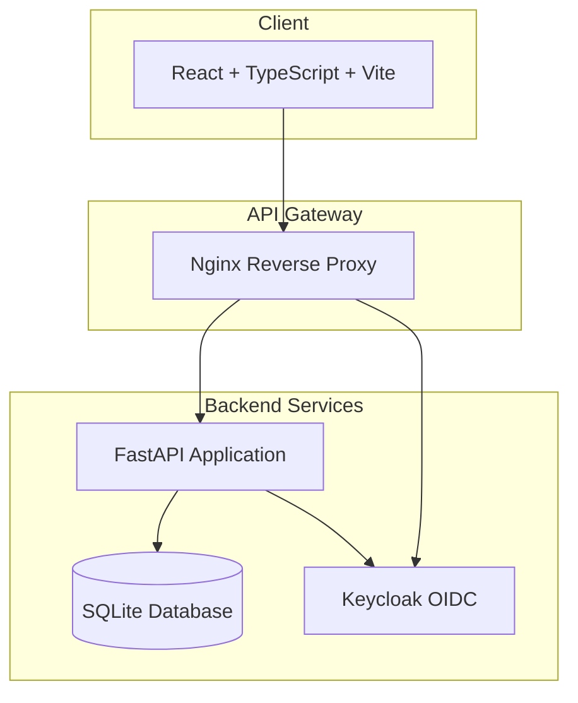

# Sentinel Lab

> Work in progress. This checkpoint may be incomplete or fail tests. See PLAN.md and STATUS.md before use.


**Ryan Vo | AI & Machine Learning**

An LLM course platform with structured roadmaps and hands-on Colab notebooks for learning Large Language Models.

## Overview

Sentinel Lab is an educational platform designed to help developers, researchers, and AI enthusiasts learn about Large Language Models through:

- **Structured Courses** - Organized learning paths with modules and lessons
- **Colab Notebooks** - Direct links to runnable Google Colab notebooks for hands-on practice
- **Learning Roadmaps** - Curated paths for specific goals (LLM Engineer, ML Researcher, etc.)
- **Progress Tracking** - Track your learning journey through courses and roadmaps

## Quick Start

### Prerequisites

- Docker and Docker Compose
- Node.js 24+ (for local frontend development)
- Python 3.12+ (for local backend development)

### Using Docker Compose (Recommended)

```bash
# Clone the repository
git clone https://github.com/A220man/sentinel-lab-ryan-vo.git
cd sentinel-lab-ryan-vo

# Copy environment template
cp .env.example .env

# Start all services
docker compose up -d

# Access the application
# Frontend: http://localhost:5173
# Backend API: http://localhost:8000
# API Docs: http://localhost:8000/docs
# Keycloak: http://localhost:8080 (admin/admin)
```

### Local Development

#### Backend

```bash
cd backend
python -m venv .venv
source .venv/bin/activate
pip install -r requirements.txt
cp ../.env.example .env
# Edit .env as needed
uvicorn app.main:app --reload --host 0.0.0.0 --port 8000
```

#### Frontend

```bash
cd frontend
npm install
npm run dev
```

## Architecture



### Technology Stack

| Layer | Technology |
|-------|------------|
| Backend | FastAPI, SQLAlchemy 2.0, Pydantic 2 |
| Frontend | React 18, TypeScript, Vite |
| Database | SQLite (dev), PostgreSQL (prod) |
| Authentication | Keycloak (OIDC/OAuth2), PKCE |
| Containerization | Docker, Docker Compose |
| Reverse Proxy | Nginx |

## Features

### Courses
- Hierarchical structure: Courses → Modules → Lessons
- Support for multiple lesson types: Colab notebooks, videos, articles, exercises
- Difficulty levels: Beginner, Intermediate, Advanced
- Tags and search/filter capabilities
- Pagination for large course catalogs

### Roadmaps
- Multi-step learning paths with optional/required steps
- Course integration - roadmap steps can reference courses
- Target audience and estimated duration
- Progress visualization

### API Endpoints

#### Courses
- `GET /api/v1/courses` - List courses (paginated, filterable)
- `POST /api/v1/courses` - Create course
- `GET /api/v1/courses/{id}` - Get course details
- `PUT /api/v1/courses/{id}` - Update course
- `DELETE /api/v1/courses/{id}` - Delete course

#### Modules
- `GET /api/v1/courses/{course_id}/modules` - List modules
- `POST /api/v1/courses/{course_id}/modules` - Create module
- `GET /api/v1/modules/{id}` - Get module
- `PUT /api/v1/modules/{id}` - Update module
- `DELETE /api/v1/modules/{id}` - Delete module

#### Lessons
- `GET /api/v1/modules/{module_id}/lessons` - List lessons
- `POST /api/v1/modules/{module_id}/lessons` - Create lesson
- `GET /api/v1/lessons/{id}` - Get lesson
- `PUT /api/v1/lessons/{id}` - Update lesson
- `DELETE /api/v1/lessons/{id}` - Delete lesson

#### Roadmaps
- `GET /api/v1/roadmaps` - List roadmaps
- `POST /api/v1/roadmaps` - Create roadmap
- `GET /api/v1/roadmaps/{id}` - Get roadmap with steps
- `PUT /api/v1/roadmaps/{id}` - Update roadmap
- `DELETE /api/v1/roadmaps/{id}` - Delete roadmap

#### Roadmap Steps
- `POST /api/v1/roadmaps/{roadmap_id}/steps` - Add step
- `PUT /api/v1/roadmap-steps/{id}` - Update step
- `DELETE /api/v1/roadmap-steps/{id}` - Delete step

## Authentication

Sentinel Lab uses Keycloak for OIDC authentication with the following roles:

| Role | Description |
|------|-------------|
| `viewer` | Can view published courses and roadmaps |
| `analyst` | Can create and manage courses and roadmaps |
| `admin` | Full administrative access (includes viewer + analyst) |

### Enabling Authentication

1. Set `OIDC_ENABLED=true` in `.env`
2. Configure Keycloak realm (imports automatically via docker-compose)
3. Update `OIDC_CLIENT_SECRET` with the Keycloak client secret
4. Restart backend service

### Demo Mode

For local development without Keycloak, authentication is disabled by default (`OIDC_ENABLED=false`). The application runs in demo mode with no authentication required.

**⚠️ Warning**: Never run with `OIDC_ENABLED=false` in production!

## Configuration

### Environment Variables

| Variable | Description | Default |
|----------|-------------|---------|
| `SECRET_KEY` | JWT signing secret | `dev-secret-change-in-production` |
| `DATABASE_URL` | SQLAlchemy database URL | `sqlite:///./sentinel_lab.db` |
| `DEBUG` | Enable debug mode | `false` |
| `OIDC_ENABLED` | Enable OIDC authentication | `false` |
| `OIDC_ISSUER_URL` | Keycloak issuer URL | `http://keycloak:8080/realms/sentinel-lab` |
| `OIDC_CLIENT_ID` | OIDC client ID | `sentinel-lab` |
| `OIDC_CLIENT_SECRET` | OIDC client secret | (required if OIDC enabled) |
| `OIDC_REDIRECT_URI` | OIDC redirect URI | `http://localhost:5173/callback` |
| `LLM_API_KEY` | LLM provider API key | (optional) |
| `LLM_PROVIDER` | LLM provider (openai, anthropic, gemini, ollama) | (optional) |
| `LLM_MODEL` | LLM model name | (optional) |
| `LLM_BASE_URL` | Custom LLM base URL | (optional) |

## Development

### Running Tests

```bash
# Backend tests
cd backend
source .venv/bin/activate
pytest

# Frontend tests
cd frontend
npm test
```

### Code Quality

```bash
# Backend linting
cd backend
source .venv/bin/activate
ruff check .

# Frontend linting
cd frontend
npm run lint
```

### Database Migrations

```bash
cd backend
source .venv/bin/activate
alembic revision --autogenerate -m "description"
alembic upgrade head
```

## Deployment

### Production Considerations

1. **Database**: Use PostgreSQL instead of SQLite
2. **Secrets**: Use Docker secrets or environment variable injection
3. **TLS**: Terminate TLS at a reverse proxy (Nginx, Traefik, Caddy)
4. **Keycloak**: Use production Keycloak deployment with external database
5. **Monitoring**: Add health checks, logging, and metrics

### Backup & Restore

```bash
# Backup SQLite database
docker compose exec backend cp /app/data/sentinel_lab.db /app/data/backup_$(date +%Y%m%d).db

# Restore
docker compose exec backend cp /app/data/backup_20240101.db /app/data/sentinel_lab.db
```

## API Documentation

Interactive API documentation is available at:
- Swagger UI: `http://localhost:8000/docs`
- ReDoc: `http://localhost:8000/redoc`

## LLM Provider Configuration

Sentinel Lab supports multiple LLM providers for AI-powered features:

| Provider | Configuration |
|----------|---------------|
| OpenAI-compatible | `LLM_PROVIDER=openai`, `LLM_API_KEY`, `LLM_MODEL`, `LLM_BASE_URL` |
| Anthropic | `LLM_PROVIDER=anthropic`, `LLM_API_KEY`, `LLM_MODEL` |
| Google Gemini | `LLM_PROVIDER=gemini`, `LLM_API_KEY`, `LLM_MODEL` |
| Ollama (local) | `LLM_PROVIDER=ollama`, `LLM_BASE_URL=http://localhost:11434`, `LLM_MODEL` |

All LLM keys are server-side only. Endpoints are configurable by the operator.

## License

MIT License - Copyright (c) 2024 Ryan Vo <ryandtvo@gmail.com>

## Contact

- **Author**: Ryan Vo
- **Email**: ryandtvo@gmail.com
- **GitHub**: [A220man](https://github.com/A220man)
- **Repository**: [sentinel-lab-ryan-vo](https://github.com/A220man/sentinel-lab-ryan-vo)